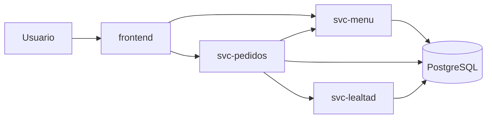

# Cafetería en línea — aplicación

Aplicación de referencia para el proyecto final de DevOps. El sistema permite
consultar un menú, armar un carrito, confirmar pedidos y acumular puntos de
lealtad. La prioridad del proyecto es demostrar un ciclo completo de desarrollo,
construcción, despliegue GitOps y observabilidad sobre Kubernetes.

> **Estado actual:** `svc-menu` cuenta con un MVP ejecutable, pruebas y entorno
> contenedorizado con PostgreSQL. `svc-pedidos`, `svc-lealtad` y `frontend`
> conservan por ahora su contrato y estructura inicial.

## Repositorios

| Repositorio | Responsabilidad |
|---|---|
| [`cafeteria-app`](https://github.com/Migue98/cafeteria-app) | Código fuente, pruebas, Containerfiles, contratos OpenAPI y pipelines de Tekton. |
| [`cafeteria-gitops`](https://github.com/Migue98/cafeteria-gitops) | Estado deseado de Kubernetes, overlays, Argo CD y observabilidad. |

Tekton construirá imágenes inmutables identificadas por SHA y actualizará el
repositorio GitOps. Argo CD será el único componente autorizado para aplicar el
estado deseado al clúster.

## Equipo

| Integrante | GitHub |
|---|---|
| Miguel Alberto Bazán Silva | [`@Migue98`](https://github.com/Migue98) |
| González Nava Alicia Aislinn | [`@aliceaislinn`](https://github.com/aliceaislinn) |
| Quintero Rubio Martín | [`@mquinteror1000`](https://github.com/mquinteror1000) |

Las responsabilidades concretas se asignarán mediante Issues y Pull Requests;
la tabla no implica propiedad exclusiva sobre componentes.

## Arquitectura funcional



| Componente | Responsabilidad |
|---|---|
| `frontend` | Menú, carrito, confirmación del pedido y consulta de puntos. |
| `svc-menu` | Productos, precios y disponibilidad. |
| `svc-pedidos` | Creación, persistencia y consulta de pedidos. |
| `svc-lealtad` | Movimientos y saldo de puntos por cliente. |
| PostgreSQL | Persistencia; no cuenta como microservicio. |

Los detalles están en la [arquitectura](docs/architecture.md) y la
[especificación funcional](docs/application-specification.md).

## Contratos HTTP

- OpenAPI 3.1 es la fuente de verdad de los tres backends.
- Las rutas de negocio usan `/api/v1`.
- Todos los servicios exponen `GET /health` y `GET /metrics`.
- Los importes se expresan en centavos enteros y moneda MXN.
- Los errores usan `application/problem+json`.
- La creación de pedidos y la acreditación de puntos requieren
  `Idempotency-Key`.

Los archivos fuente, convenciones y ejemplos están en
[`docs/openapi/`](docs/openapi/README.md).

## Estructura

```text
.
├── frontend/          # Interfaz web
├── svc-menu/          # Catálogo y disponibilidad
├── svc-pedidos/       # Pedidos y totales
├── svc-lealtad/       # Puntos y movimientos
├── tests/             # Pruebas integrales y de contratos
├── tekton/            # Tasks, Pipeline y Triggers
├── docs/              # Arquitectura, decisiones y OpenAPI
└── scripts/           # Validaciones auxiliares
```

Cada servicio incorporará `src/`, `tests/`, `requirements.txt`,
`Containerfile`, `.dockerignore` y su documentación operativa cuando comience
la implementación.

## Validación disponible

Requisito: Python 3.11 o posterior. El validador actual solo utiliza la
biblioteca estándar.

```bash
git clone https://github.com/Migue98/cafeteria-app.git
cd cafeteria-app
python scripts/validate_contracts.py
```

El comando debe finalizar con `Contratos válidos: 3`.

Para validar el servicio implementado:

```bash
cd svc-menu
python -m pip install -r requirements-dev.txt
python -m pytest -p no:cacheprovider
ruff check app tests
ruff format --check app tests
```

## Forma de trabajo

1. Crear o elegir un Issue con alcance y criterio de aceptación.
2. Crear una rama corta desde `main`: `feat/...`, `fix/...`, `docs/...` o
   `ops/...`.
3. Actualizar primero el contrato OpenAPI si cambia una interfaz HTTP.
4. Ejecutar las validaciones relacionadas y abrir un Pull Request.
5. Solicitar al menos una revisión antes de integrar a `main`.

No se versionan tokens, contraseñas, kubeconfigs, llaves privadas ni archivos
`.env`. Consulta [CONTRIBUTING.md](CONTRIBUTING.md) antes de comenzar.

## Documentación

- [Índice de documentación](docs/README.md)
- [Plan de implementación](docs/implementation-plan.md)
- [ADR-001: stack inicial](docs/decisions/ADR-001-stack.md)
- [ADR-002: contratos HTTP](docs/decisions/ADR-002-api-contracts.md)

## Siguiente hito

Integrar el MVP de `svc-menu` y usar su patrón operativo para implementar
`svc-pedidos`: contrato, persistencia, idempotencia, métricas y pruebas.
