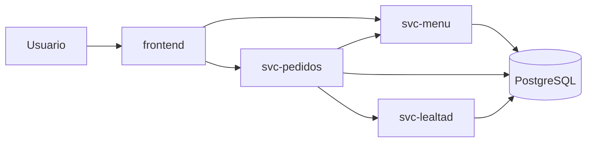

# Cafetería en línea — aplicación

Aplicación de referencia para el proyecto final de DevOps. El sistema permite
consultar un menú, armar un carrito, confirmar pedidos y acumular puntos de
lealtad. La prioridad del proyecto es demostrar un ciclo completo de desarrollo,
construcción, despliegue GitOps y observabilidad sobre Kubernetes.

> **Estado actual:** el frontend y los tres backends (`svc-menu`, `svc-pedidos`
> y `svc-lealtad`) cuentan con MVP ejecutable, pruebas y entorno
> contenedorizado con PostgreSQL. La plataforma de observabilidad y el cierre
> del software están implementados y validados localmente; la integración
> con infraestructura y la publicación siguen pendientes.

Para incorporarte al equipo, comienza por la
[guía de entrega y reproducción](docs/team-handoff.md): requisitos, configuración,
arranque, recorrido manual, observabilidad, pruebas y solución de problemas.

## Repositorios

| Repositorio | Responsabilidad |
|---|---|
| [`cafeteria-app`](https://github.com/Migue98/cafeteria-app) | Código fuente, pruebas, Containerfiles y contratos OpenAPI. La carpeta de Tekton conserva la propuesta pendiente. |
| [`cafeteria-gitops`](https://github.com/Migue98/cafeteria-gitops) | Diseño del estado deseado de Kubernetes, overlays, Argo CD y observabilidad; se retomará al terminar la web. |

Tekton construirá imágenes inmutables identificadas por SHA y actualizará el
repositorio GitOps. Argo CD será el único componente autorizado para aplicar el
estado deseado al clúster.

## Equipo

| Integrante | GitHub |
|---|---|
| Miguel Alberto Bazán Silva | [`@Migue98`](https://github.com/Migue98) |
| González Nava Alicia Aislinn | [`@aliceaislinn`](https://github.com/aliceaislinn) |
| Quintero Rubio Martín | [`@mquinteror1000`](https://github.com/mquinteror1000) |

Las responsabilidades concretas se asignarán mediante Issues y Pull Requests;
la tabla no implica propiedad exclusiva sobre componentes.

## Arquitectura funcional



| Componente | Responsabilidad |
|---|---|
| `frontend` | Menú Jinja/HTMX, carrito, confirmación del pedido, historial y puntos. |
| `svc-menu` | Productos, precios y disponibilidad. |
| `svc-pedidos` | Creación, persistencia y consulta de pedidos. |
| `svc-lealtad` | Movimientos y saldo de puntos por cliente. |
| PostgreSQL | Persistencia; no cuenta como microservicio. |

Los detalles están en la [arquitectura](docs/architecture.md) y la
[especificación funcional](docs/application-specification.md).

## Contratos HTTP

- OpenAPI 3.1 es la fuente de verdad de los tres backends.
- Las rutas de negocio usan `/api/v1`.
- Todos los servicios exponen `GET /health` y `GET /metrics`.
- El frontend protege los formularios con CSRF, sirve HTMX localmente y permite
  configurar cookies y hosts para producción. Consulta la
  [guía de seguridad web](docs/web-security.md) antes de exponer la aplicación.
- Los cuatro servicios emiten logs JSON y propagan el contexto de la petición;
  consulta la [guía de logs y correlación](docs/application-observability.md).
- Pedidos recupera automáticamente las acreditaciones pendientes cuando
  lealtad vuelve a estar disponible.
- Los importes se expresan en centavos enteros y moneda MXN.
- Los errores usan `application/problem+json`.
- La creación de pedidos y la acreditación de puntos requieren
  `Idempotency-Key`.

Los archivos fuente, convenciones y ejemplos están en
[`docs/openapi/`](docs/openapi/README.md).

## Estructura

```text
.
├── frontend/          # Interfaz web: app/routes, services, templates y static; tests/
├── svc-menu/          # Catálogo: app/, db/init.sql, db/seed.sql y tests/
├── svc-pedidos/       # Pedidos: app/routes y services, db/init.sql y tests/
├── svc-lealtad/       # Puntos: app/, db/init.sql y tests/
├── tests/
│   ├── smoke/         # Comprobación rápida del entorno local levantado
│   ├── e2e/           # Escenarios HTTP con Compose aislado
│   ├── browser/       # Clics y temporizadores de HTMX con Chromium real
│   ├── monitoring/    # Plataforma local real: métricas, logs, trazas y Grafana
│   └── observability/ # Contrato común de logs y correlación
├── scripts/           # Ejecución E2E, validación OpenAPI y generación de locks
├── .github/workflows/ # CI del frontend, backends y pruebas E2E
├── tekton/            # Documentación del pipeline previsto; sin recursos todavía
├── observability/     # Prometheus, Grafana, Alloy, Loki y Tempo en local
├── docs/              # Arquitectura, decisiones, OpenAPI y guías operativas
├── compose.yaml       # Frontend, tres backends y PostgreSQL para desarrollo local
├── compose.public.yaml # Ajustes para proxy HTTPS; no configura ni inicia el proxy
├── compose.monitoring.yaml # Extensión opcional de Prometheus y Grafana
├── compose.telemetry.yaml  # Extensión adicional de Alloy, Loki y Tempo
└── compose.telegram.yaml   # Notificaciones opcionales de Grafana a Telegram
```

Cada backend contiene su aplicación, pruebas, dependencias, `Containerfile`,
`.dockerignore`, Compose individual y documentación operativa.

El frontend y pedidos separan `main.py` (configuración), `routes/` (HTTP) y
`services/` (operaciones). La [organización del código](docs/code-organization.md)
describe las dependencias, presentación, errores, métricas y persistencia.

Las pruebas de cada componente viven en su propio `tests/`. Las que abarcan
varios componentes viven en el `tests/` de la raíz. `scripts/` contiene los
comandos auxiliares: `run_e2e.py` prepara Compose y llama a pytest,
`validate_contracts.py` valida los contratos de `docs/openapi/` y
`compile_requirements.py` regenera los locks de dependencias.

Cada backend conserva su esquema en `db/init.sql`; menú separa los productos
de ejemplo en `db/seed.sql`. El Compose raíz monta los cuatro archivos, en ese
orden, para inicializar una única instancia y base de PostgreSQL vacía:
menú administra productos; pedidos, pedidos e ítems; lealtad, saldos,
movimientos y claves de acreditación. Consulta la
[integración local](docs/local-integration.md) y la
[inicialización de BD](docs/database-initialization.md).

## Integración local

Desde una copia local del repositorio, con Docker Desktop iniciado en modo
contenedores Linux:

```powershell
if (-not (Test-Path -LiteralPath .env)) {
    Copy-Item -LiteralPath .env.example -Destination .env
}
docker compose -f compose.yaml config --quiet
docker compose -f compose.yaml up --build --detach
docker compose -f compose.yaml ps
```

El Compose raíz levanta el frontend, PostgreSQL y los tres backends. Abre
`http://localhost:8000` para usar la aplicación. Consulta la
[guía de integración local](docs/local-integration.md) para ver puertos,
configuración, prueba completa y limpieza del volumen. Para comprobar el flujo
con Python 3.13, `py -3.13 tests/smoke/check_compose.py` crea un pedido de prueba
en la base local. `docker compose -f compose.yaml down` detiene y conserva datos.
La guía también describe la alternativa Podman.

Para añadir Prometheus y Grafana locales, con datos persistentes y conexión
automática a las métricas:

```bash
docker compose -f compose.yaml -f compose.monitoring.yaml up --build --detach
```

Grafana está en `http://localhost:3000` y Prometheus en `http://localhost:9090`.
Las credenciales, consultas y pruebas están en la
[guía de monitoreo local](docs/local-monitoring.md).

Para recoger también logs y trazas y navegar entre ellos desde Grafana:

```bash
docker compose -f compose.yaml -f compose.monitoring.yaml -f compose.telemetry.yaml up --build --detach
```

La [guía de logs y trazas](docs/local-logs-traces.md) explica las consultas,
persistencia, uso del socket Docker y validación con Chromium.

Grafana también carga los dashboards de **aplicación** y **negocio** y las
reglas de disponibilidad, errores HTTP y puntos pendientes. La
[guía de dashboards y alertas](docs/local-dashboards-alerts.md) explica sus
umbrales, la activación opcional de Telegram y las pruebas de notificaciones.

## Validación disponible

Usa Python 3.13, la línea acordada para el proyecto. El validador de contratos
solo utiliza la biblioteca estándar.

Desde la raíz:

```powershell
py -3.13 scripts/validate_contracts.py
```

El comando debe finalizar con `Contratos válidos: 3`.

Para recorrer el frontend, los tres backends y PostgreSQL de extremo a extremo en un
Compose aislado:

```powershell
py -3.13 -m venv tests/.venv
.\tests\.venv\Scripts\python.exe -m pip install --require-hashes -r tests/requirements.txt
.\tests\.venv\Scripts\python.exe -m playwright install chromium
.\tests\.venv\Scripts\python.exe scripts/run_e2e.py
```

Las suites cubren compra, precios, puntos, idempotencia, errores, métricas,
persistencia tras reiniciar PostgreSQL y clics reales con JavaScript y HTMX
en Chromium. En Linux, instala el navegador con `--with-deps`.
Los detalles están en
[`tests/README.md`](tests/README.md).

Para validar un backend, por ejemplo menú:

```powershell
Push-Location svc-menu
py -3.13 -m venv .venv
.\.venv\Scripts\python.exe -m pip install --require-hashes -r requirements.txt -r requirements-dev.txt
.\.venv\Scripts\python.exe -m pytest -c pyproject.toml tests ../tests/observability -p no:cacheprovider
.\.venv\Scripts\python.exe -m ruff check app tests ../tests/observability
.\.venv\Scripts\python.exe -m ruff format --check app tests ../tests/observability
Pop-Location
```

## Forma de trabajo

Los cuatro componentes comparten las reglas de `ruff.toml` y tienen la misma
configuración de pytest en su `pyproject.toml`. La
[guía de herramientas](docs/development-tooling.md) explica la versión de
Python, la instalación desde locks y los comandos que también usa CI.

1. Crear o elegir un Issue con alcance y criterio de aceptación.
2. Crear una rama corta desde `main`: `feat/...`, `fix/...`, `docs/...` o
   `ops/...`.
3. Actualizar primero el contrato OpenAPI si cambia una interfaz HTTP.
4. Ejecutar las validaciones relacionadas y abrir un Pull Request.
5. Solicitar al menos una revisión antes de integrar a `main`.

No se versionan tokens, contraseñas, kubeconfigs, llaves privadas ni archivos
`.env`. Consulta [CONTRIBUTING.md](CONTRIBUTING.md) antes de comenzar.

## Documentación

- [Índice de documentación](docs/README.md)
- [Entrega y reproducción para el equipo](docs/team-handoff.md)
- [Plan de implementación](docs/implementation-plan.md)
- [Plan del software](docs/software-roadmap.md)
- [Integración local](docs/local-integration.md)
- [ADR-001: stack inicial](docs/decisions/ADR-001-stack.md)
- [ADR-002: contratos HTTP](docs/decisions/ADR-002-api-contracts.md)

## Siguiente hito

Seguir el [plan de trabajo actualizado](docs/implementation-plan.md): acordar el
contrato con infraestructura y preparar el primer PipelineRun manual de Tekton.
El plan incorpora almacenamiento de clase 2, monitoreo de clase 3 y GitOps de
clase 4, con criterios verificables hasta la presentación del 4 de diciembre.

Reproducir la
[guía de entrega](docs/team-handoff.md) en los equipos de Alicia y Martín a partir
del commit compartido en `main`, comprobando sus resultados en
[GitHub Actions](https://github.com/Migue98/cafeteria-app/actions).
La [revisión visual y de usabilidad](docs/visual-usability-review.md)
está validada en cinco anchos; las doce pruebas de Chromium cubren carrito,
compra, historial, teclado, errores y recuperación.

La observabilidad local está implementada y validada: OpenTelemetry,
Prometheus, Grafana, Alloy, Loki, Tempo, dashboards técnicos y de negocio y
alertas. La [guía de dashboards y alertas](docs/local-dashboards-alerts.md)
incluye la extensión opcional de Telegram y la evidencia del envío real desde
Grafana. Cada equipo debe configurar sus propias credenciales locales.
Kubernetes, Tekton y GitOps son la fase vigente del proyecto; su implementación
y ejecución en el clúster siguen pendientes.
El orden y el estado de los bloques están en el
[plan del software](docs/software-roadmap.md).
