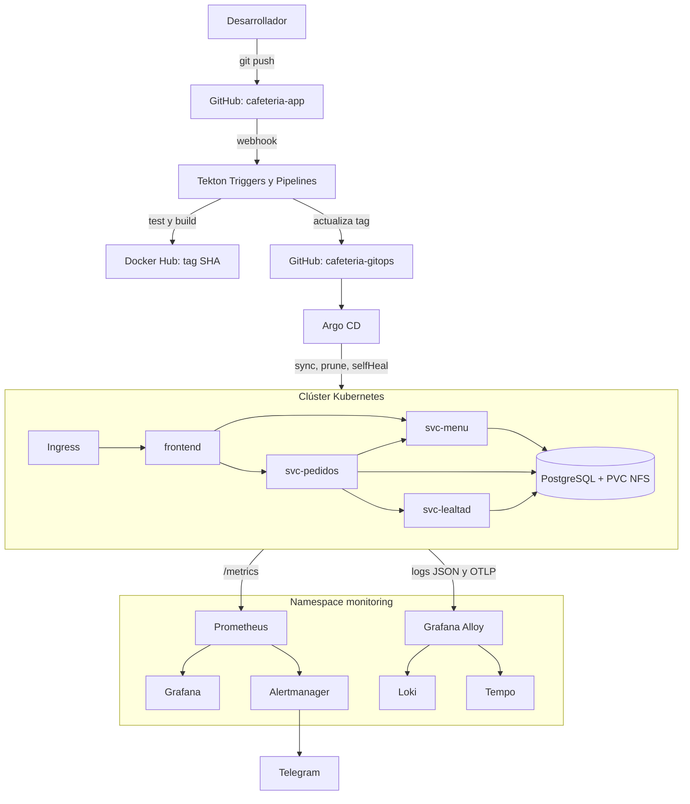

# Arquitectura propuesta

## Principios

- La ruta de producción es Git: Tekton construye y modifica GitOps; Argo CD despliega.
- Las imágenes son inmutables por SHA y no se utiliza `latest`.
- Los servicios no dependen de direcciones IP fijas; usan DNS de Kubernetes.
- Los datos persistentes viven en PVC, no dentro de la capa escribible del contenedor.
- Métricas, logs y trazas comparten `service`, `namespace` y `trace_id` para permitir correlación.
- Los componentes administrativos no se exponen directamente a Internet.

## Comunicación de la aplicación

La primera versión utilizará REST síncrono. `svc-pedidos` consulta el menú, persiste el pedido y solicita la asignación de puntos. Si la asignación de puntos falla, el pedido debe conservarse y registrar el error para permitir recuperación; no se implementará una transacción distribuida en el MVP.
