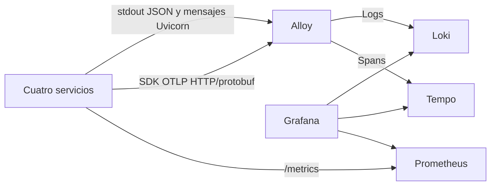

# Logs y trazas en Grafana local

El paso 3 conecta los logs JSON y los spans OpenTelemetry de los cuatro
servicios con Grafana. Alloy recoge stdout de Docker y lo envía a Loki;
también recibe OTLP HTTP/protobuf y reenvía los spans a Tempo. Grafana
provisiona ambas fuentes y permite navegar entre un log y su traza.

Se utilizan los componentes oficiales, sin implementar un colector propio.

| Componente | Versión | Función |
|---|---|---|
| Grafana Alloy | 1.22.0 | Descubrimiento de contenedores, lectura de logs y recepción/exportación OTLP. |
| Grafana Loki | 3.7.10 | Almacenamiento y consultas LogQL de los logs. |
| Grafana Tempo | 3.1.1 | Almacenamiento y consultas de trazas distribuidas. |

Las imágenes están fijadas por digest en
[`compose.telemetry.yaml`](../compose.telemetry.yaml). Prometheus y Grafana
mantienen las versiones del [paso 2](local-monitoring.md).

## Levantar la plataforma

Desde la raíz del repositorio, con Docker Desktop y contenedores Linux:

```powershell
docker compose -f compose.yaml -f compose.monitoring.yaml -f compose.telemetry.yaml up --build --detach
```

La combinación mantiene los siete servicios del monitoreo y añade Alloy,
Loki y Tempo: diez contenedores en ejecución. Un contenedor auxiliar
`telemetry-storage-init` asigna los volúmenes a UID/GID `10001:10001` y termina
con código 0. Loki y Tempo ejecutan sus procesos con el usuario de sus imágenes.
Este auxiliar reutiliza la imagen fijada de Alloy y no modifica archivos del host.

| Interfaz | URL local | Variable de puerto |
|---|---|---|
| Cafetería | http://localhost:8000 | `FRONTEND_PORT` |
| Grafana | http://localhost:3000 | `GRAFANA_PORT` |
| Prometheus | http://localhost:9090 | `PROMETHEUS_PORT` |
| Loki | http://localhost:3100/ready | `LOKI_PORT` |
| Tempo | http://localhost:3200/ready | `TEMPO_PORT` |
| Alloy | http://localhost:12345 | `ALLOY_PORT` |

Las interfaces de observabilidad se publican únicamente en `127.0.0.1`.
Grafana usa la cuenta de desarrollo descrita en
[monitoreo local](local-monitoring.md#iniciar). El receptor OTLP `alloy:4318`
y el de Tempo no se publican en el host.

La extensión activa `OTEL_TRACES_EXPORTER=otlp` en los cuatro componentes y
establece `http://alloy:4318` como destino. El intervalo de lotes es un segundo
si no se establece `OTEL_BSP_SCHEDULE_DELAY`; una variable existente en `.env`
se conserva. La aparición de datos puede tardar varios segundos. El primer
arranque de Loki incluye una espera de disponibilidad aproximada de 15 segundos.

El Compose normal conserva sus cinco servicios y la exportación `none`.
El modo de solo métricas sigue disponible con los dos primeros archivos.

## Recorrido de los datos



Alloy descubre únicamente el proyecto Compose activo mediante
`com.docker.compose.project` y conserva `frontend`, `svc-menu`, `svc-pedidos`
y `svc-lealtad`. No recoge PostgreSQL, los colectores ni otros proyectos.
Los logs conservan su línea original; se analiza el JSON para extraer nivel,
timestamp e identificadores. Los mensajes operativos de Uvicorn también
se conservan aunque no sean JSON.

Las etiquetas de consulta son `job="cafeteria"`, `service`, `compose_project`
y, cuando existe, `level`. Los identificadores `trace_id`, `span_id` y
`request_id` se guardan como metadatos estructurados y dentro del JSON,
sin indexar una etiqueta distinta por cada petición. Loki puede añadir
etiquetas propias, como `service_name`.

La traza conserva los recursos `service.name` del SDK. Una compra incluye
servidores FastAPI, clientes HTTPX y consultas Psycopg de los tres backends.
Tempo funciona como una instancia local monolítica con `-target=all`,
almacenamiento en disco y sin Kafka.

## Consultar y navegar

1. Haz una compra en la cafetería. En Grafana abre **Explore** y selecciona
   **Loki**. Consulta los eventos con:

   ```logql
   {job="cafeteria"} | json | message="request_completed"
   ```

2. Para localizar errores o un servicio concreto:

   ```logql
   {job="cafeteria", level="ERROR"}
   {job="cafeteria", service="svc-pedidos"} | json | status_code >= 500
   ```

3. Abre el menú de una línea, elige **Show log details** y pulsa **Ver traza**
   en sus campos. Grafana abre Tempo con el `trace_id` extraído del JSON.
   Verás los servicios, operaciones, duración y relaciones padre/hijo.

4. Selecciona un span servidor y pulsa **Logs for this trace**. Se consulta
   Loki con la traza y el servicio de ese span, ampliando el rango de tiempo
   un minuto antes y después. Para ver todos los servicios de la traza usa:

   ```logql
   {job="cafeteria"} |= "REEMPLAZA_POR_TRACE_ID"
   ```

5. También puedes seleccionar **Tempo**, abrir una traza por su ID o buscar
   peticiones del frontend con TraceQL:

   ```traceql
   { resource.service.name = "frontend" }
   { status = error }
   ```

Un log puede conservar un ID aunque el span no se exporte por una decisión
de muestreo o una interrupción de recolección. El muestreo predeterminado
exporta las trazas raíz y respeta la decisión del padre remoto. Las líneas
operativas sin `trace_id` no muestran el enlace. Los eventos sin petición
del worker pueden tener identificadores `null`.

Las fuentes tienen UID estable `cafeteria-loki` y `cafeteria-tempo` y se
mantienen desde
[`telemetry-datasources.yaml`](../observability/grafana/telemetry-datasources.yaml).
Los dobles signos `$${...}` son el escape de variables de Grafana en el
provisioning, no una variable que deba reemplazarse a mano.

## Persistencia y alcance local

| Volumen adicional | Ruta | Contenido |
|---|---|---|
| `cafeteria-loki-data` | `/loki` | Chunks, índices TSDB, WAL y datos del compactor. |
| `cafeteria-tempo-data` | `/var/tempo` | WAL, bloques de trazas y trabajo local. |
| `cafeteria-alloy-data` | `/var/lib/alloy/data` | Estado y posiciones de lectura del colector. |

Junto con PostgreSQL, Prometheus y Grafana hay seis volúmenes. Compose les
antepone el nombre del proyecto. Loki y Tempo tienen una retención configurada
de siete días; la eliminación es periódica, no un límite máximo de disco.
Los límites de RAM son 512 MiB para Loki, 1 GiB para Tempo y 384 MiB para Alloy.
Los lotes y las colas OTLP del SDK y Alloy son acotados y están en memoria:
una interrupción prolongada o un cierre brusco puede perder spans pendientes.
La persistencia protege los datos recibidos y guardados, no garantiza entrega
sin pérdidas. Los logs dependen también de la conservación del stdout en Docker.

Alloy monta el socket Docker para descubrir y leer los contenedores. Aunque
el montaje sea `:ro`, esto **no convierte la API de Docker en solo lectura**:
el proceso tiene acceso administrativo al daemon. Los filtros de proyecto
limitan la configuración de recolección, no los permisos de esa API. Este
modo es para el desarrollo local con un colector de confianza. No se expone
el socket por TCP. `DOCKER_SOCKET_PATH` permite cambiar la ruta del socket;
la validación de este paso se hizo con Docker Desktop.

Loki y Tempo no tienen autenticación propia en esta configuración local.
Sus APIs quedan en loopback y en la red de Compose; este perfil no es la
configuración de publicación. Kubernetes, almacenamiento y acceso público
se integrarán con el responsable de infraestructura.

Detener y conservar los datos:

```powershell
docker compose -f compose.yaml -f compose.monitoring.yaml -f compose.telemetry.yaml down
```

Usa los tres archivos también al apagar o cambiar de modo. Añadir `--volumes`
elimina los seis volúmenes, incluida la base de la cafetería de ese proyecto.

## Pruebas automatizadas

Con el entorno de [`tests/README.md`](../tests/README.md) y Chromium instalado:

```powershell
.\tests\.venv\Scripts\python.exe scripts/run_monitoring_e2e.py --telemetry
```

El runner valida Compose, Prometheus con `promtool` y las configuraciones con
los validadores nativos de Alloy, Loki y Tempo. Ejecuta cuatro pruebas de
métricas, dos de dashboards incorporadas en el paso 4 y cinco de trazas:

1. Fuentes Loki/Tempo provisionadas con enlaces en ambas direcciones.
2. Compra con logs de los cuatro servicios, mismos IDs que los spans HTTP/SQL
   de Tempo y árbol padre/hijo completo; IDs fuera del índice de etiquetas.
3. Caída real de menú: respuesta 503, log ERROR y span con estado de error.
4. Recreación de Loki, Tempo y Alloy conservando logs y los mismos spans.
5. Chromium inicia sesión, abre una traza desde un log de error y regresa
   mediante el enlace a una consulta Loki del mismo servicio y traza.

El proyecto desechable es `cafeteria-monitoring-e2e`. Añade los puertos `13100`,
`13200` y `12346` a los documentados para métricas. Se pueden cambiar con
`MONITORING_E2E_LOKI_PORT`, `MONITORING_E2E_TEMPO_PORT` y
`MONITORING_E2E_ALLOY_PORT`. Genera credenciales aleatorias y limpia sus
contenedores, red y seis volúmenes al terminar. No modifica los datos del
Compose normal. Los escenarios se ejecutan en serie porque detienen y recrean
servicios; los dos modos del runner tampoco se ejecutan simultáneamente en
el mismo equipo, pues comparten proyecto y puertos.

`KEEP_MONITORING_STACK=1` conserva el entorno para inspección. Antes de repetir,
baja ese proyecto con los tres archivos y `--volumes`, y espera a que termine
el apagado: la siguiente ejecución genera credenciales distintas. Las capturas
`grafana-log-to-trace.png` y `grafana-trace-to-logs.png` quedan en
`test-results/monitoring/`, excluido de Git. El workflow **Local monitoring**
comprueba ambos modos en jobs independientes.

El [paso 4](local-dashboards-alerts.md) añade dashboards de aplicación y negocio,
alertas y Telegram opcional. `--telemetry --alerts` incorpora cuatro casos
adicionales de reglas y notificaciones, para quince casos en total.

## Evidencia local — 26 de noviembre de 2026

| Comprobación | Resultado |
|---|---|
| Configuración | Compose y validadores nativos de Prometheus, Alloy, Loki y Tempo aprobados. |
| Integración completa | Nueve pruebas aprobadas en 207.93 segundos. |
| Compatibilidad con solo métricas | Cuatro pruebas aprobadas en 72.65 segundos usando únicamente los dos primeros archivos Compose. |
| Compra | Logs de los cuatro servicios y spans HTTP/SQL correlacionados por IDs reales del SDK; árbol padre/hijo completo. |
| Error | Menú detenido durante el checkout: respuesta 503, log ERROR y span de error enlazados. |
| Persistencia | Mismos spans y logs recuperados tras recrear Loki, Tempo y Alloy. |
| Navegador | Chromium recorrió log → traza → logs del mismo servicio; no hubo errores de JavaScript. |
| Provisioning | Fuentes de datos estables y enlaces funcionales en ambas direcciones. |
| Aislamiento | Configuración limitada al proyecto y cuatro servicios; identificadores fuera del índice de etiquetas. |

Las capturas positivas se revisaron visualmente. Los registros de ambos runners
confirman la eliminación de sus contenedores, volúmenes y red al terminar.
La aplicación normal permaneció apagada. Las pruebas de
CI están preparadas localmente y su ejecución remota queda pendiente de publicar.
Continúa una advertencia conocida de la fixture `base_url` de Playwright,
sin causar fallos.

Referencias:
[descubrimiento Docker](https://grafana.com/docs/alloy/latest/reference/components/discovery/discovery.docker/),
[lectura de logs](https://grafana.com/docs/alloy/latest/reference/components/loki/loki.source.docker/),
[receptor OTLP](https://grafana.com/docs/alloy/latest/reference/components/otelcol/otelcol.receiver.otlp/),
[Tempo local](https://grafana.com/docs/tempo/latest/set-up-for-tracing/setup-tempo/deploy/locally/linux/),
[Loki en Grafana](https://grafana.com/docs/grafana/latest/datasources/loki/configure/) y
[trazas a logs](https://grafana.com/docs/grafana/latest/datasources/tempo/configure-tempo-data-source/configure-trace-to-logs/).
