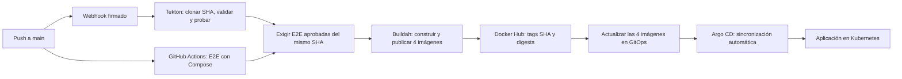

# Plan de CI/CD con Tekton y Argo CD

- Estado: propuesta para implementar por etapas; todavía no hay Tasks ni Pipeline desplegados.
- Fecha: 26 de noviembre de 2026.
- Aplicación: `Migue98/cafeteria-app`.
- Estado deseado: `Migue98/cafeteria-gitops`.

## Punto de partida

La aplicación ya tiene cuatro Containerfiles, locks de dependencias, validación
OpenAPI, pruebas por componente y E2E con Compose. GitHub Actions ejecuta esas
comprobaciones. `tekton/` contiene por ahora documentación y GitOps todavía no
tiene manifiestos desplegables.

La consigna exige el recorrido: clonar, probar, construir y publicar imágenes
con el SHA del commit, actualizar GitOps y permitir que Argo CD sincronice.
Construir imágenes en GitHub Actions por sí solo no completa esa parte de la
[consigna del proyecto](https://gitlab.com/mabs98/tsic2-2027-1/-/blob/main/material/05-proyecto-final/proyecto-final-devops-2026.html).

## Flujo propuesto



Tekton produce imágenes y modifica Git. Argo CD aplica el estado deseado;
su sincronización automática permite que el pipeline no necesite acceso a su
API para desplegar. Véase [Argo CD: automated sync](https://argo-cd.readthedocs.io/en/stable/user-guide/auto_sync/).

## Recursos de Tekton

| Recurso | Función en este proyecto |
|---|---|
| `Task` | Receta reutilizable: clonar, probar un componente, construir una imagen o actualizar GitOps. |
| `Pipeline` | Define las tareas, sus dependencias y los parámetros comunes. |
| `PipelineRun` | Ejecuta el pipeline para una revisión concreta y asigna recursos y credenciales. |
| `Workspace` | Comparte el checkout entre tareas mediante un volumen. |
| `EventListener` | Recibe el webhook de GitHub. |
| `TriggerBinding` | Extrae la revisión y otros datos necesarios del evento. |
| `TriggerTemplate` | Construye el `PipelineRun` a partir de esos datos. |

El checkout usará un PVC por ejecución mediante `volumeClaimTemplate`. Un
`emptyDir` de una Task no comparte archivos con los pods de otras Tasks.
El modo de acceso y el paralelismo dependerán de la StorageClass disponible.
[Referencia de Workspaces](https://tekton.dev/docs/pipelines/workspaces/).

## Tareas del pipeline

| Tarea propuesta | Entrada y resultado |
|---|---|
| `git-clone` | Clona la URL permitida y hace checkout del SHA completo recibido. |
| `validate-contracts` | Ejecuta `python scripts/validate_contracts.py`. |
| `python-check` | Se reutiliza para los cuatro componentes: instala locks, ejecuta Ruff y pytest. |
| `wait-e2e` | Espera una ejecución satisfactoria del workflow E2E para ese mismo SHA. |
| `buildah-build-push` | Se reutiliza cuatro veces, con el contexto y Containerfile de cada componente; devuelve URL y digest. |
| `update-gitops` | Modifica las cuatro referencias de imagen en un solo commit después de aprobar todas las tareas anteriores. |

La Task de pruebas conservará entornos de Python separados por componente.
Desde la carpeta correspondiente ejecutará los comandos ya usados en CI:

```sh
python -m pip install --require-hashes -r requirements.txt -r requirements-dev.txt
ruff check app tests ../tests/observability
ruff format --check app tests ../tests/observability
python -m pytest -c pyproject.toml tests ../tests/observability -p no:cacheprovider
```

Inicialmente las construcciones se ejecutarán de forma secuencial para conocer
el consumo real del clúster. Se puede aumentar el paralelismo después de medir
CPU, RAM y almacenamiento temporal.

## E2E: adaptación necesaria

`scripts/run_e2e.py` invoca Docker Compose y los escenarios de fallas detienen,
pausan o reinician contenedores. Ejecutar ese script dentro de una Task necesita
un motor de contenedores; instalar la CLI de Docker no lo proporciona.

Para la primera versión se conserva ese entorno en GitHub Actions y se añade
una condición obligatoria en Tekton antes de publicar:

- Consultar el workflow `.github/workflows/e2e-ci.yml` del repositorio esperado.
- Comprobar SHA completo, rama `main` y evento `push`.
- Continuar solo con `status=completed` y `conclusion=success`.
- Esperar con un tiempo máximo cuando esté en cola o ejecutándose.
- Detener el pipeline si falla, se cancela, no aparece o vence el tiempo máximo.

No sirve consultar la última ejecución exitosa de la rama: podría pertenecer
a código anterior. También habrá que ajustar el disparo del workflow E2E para
que cada push a `main` que inicie Tekton tenga su ejecución correspondiente;
la opción inicial más sencilla es ejecutar E2E en todos los pushes a `main`.
Así los cambios solo de pipeline o documentación no dejan una espera sin resultado.

Tekton seguirá ejecutando las pruebas de los cuatro servicios dentro del
clúster. Si después se decide trasladar también la integración al clúster,
se preparará un entorno aislado para las imágenes candidatas y se adaptarán
los escenarios actuales de Docker; esa migración es un trabajo adicional.

## Construcción y publicación

Se propone Buildah, reutilizando una Task revisada del catálogo y fijando
su revisión e imagen por digest. Cada construcción debe indicar expresamente
`Containerfile`; el nombre predeterminado de la Task de referencia es
`Dockerfile`. La [Task Buildah de referencia](https://github.com/tektoncd/catalog/blob/main/task/buildah/0.9/buildah.yaml)
también declara un contexto privilegiado: antes de ejecutarla se debe acordar
con infraestructura qué configuración de builder permite el clúster.

| Componente | Contexto | Containerfile | Imagen propuesta |
|---|---|---|---|
| Frontend | `frontend/` | `frontend/Containerfile` | `docker.io/<cuenta>/cafeteria-frontend:<SHA>` |
| Menú | `svc-menu/` | `svc-menu/Containerfile` | `docker.io/<cuenta>/cafeteria-menu:<SHA>` |
| Pedidos | `svc-pedidos/` | `svc-pedidos/Containerfile` | `docker.io/<cuenta>/cafeteria-pedidos:<SHA>` |
| Lealtad | `svc-lealtad/` | `svc-lealtad/Containerfile` | `docker.io/<cuenta>/cafeteria-lealtad:<SHA>` |

`<cuenta>` se sustituirá por la cuenta u organización acordada y `<SHA>` por
el commit completo del código fuente. Además del tag requerido por la consigna,
el pipeline conservará los digests de las imágenes para fijar lo desplegado.
No se usará `latest` para promover una versión.

El repositorio original de Kaniko está archivado; no se adopta esa distribución
como opción inicial. [Estado del proyecto original](https://github.com/GoogleContainerTools/kaniko).

## Contrato con GitOps

Se propone centralizar las cuatro referencias de imagen en
`overlays/production/kustomization.yaml` de `cafeteria-gitops`. Ese archivo aún
no existe: primero deben crearse las bases de los componentes y el overlay.
La Task de actualización tendrá una ruta y nombres de imagen conocidos.

Después de publicar las cuatro imágenes:

1. Clonar GitOps y actualizar sus referencias con los resultados del build.
2. Renderizar el overlay y comprobar que contiene las cuatro imágenes esperadas.
3. Registrar el SHA del código fuente promovido y crear un solo commit.
4. Hacer push normal, sin `--force`. Si otro pipeline avanzó la rama, releer
   el estado antes de reintentar y evitar promover una revisión anterior a la ya registrada.
5. Argo CD sincroniza y permite verificar `Synced` y `Healthy`.

Si una construcción falla, puede haber imágenes de otras tareas ya publicadas,
pero el pipeline no debe cambiar GitOps ni promover una combinación parcial.
La cuenta de ejecución de CI no necesita permisos para aplicar Deployments
de la tienda. La instalación inicial de plataforma y el registro de Tasks se
coordinan con infraestructura; la demo de despliegue parte del push a Git.

## Webhook y credenciales

Primero se validará un `PipelineRun` manual; después se conectará GitHub al
EventListener mediante HTTPS accesible desde GitHub. Si el clúster está en LAN,
se acordará y documentará el endpoint o túnel que recibirá el evento.

Se utilizará el interceptor GitHub con `secretRef` y un filtro CEL que acepte
solo eventos `push` del repositorio esperado para `refs/heads/main`, excluyendo
eliminaciones de rama. El interceptor puede verificar la firma del webhook;
[referencia oficial](https://tekton.dev/docs/triggers/interceptors/#github-interceptors).

| Credencial | Uso y alcance |
|---|---|
| Docker Hub | Publicar las cuatro imágenes acordadas. |
| GitHub para GitOps | Escribir contenido únicamente en el repositorio GitOps. |
| GitHub para consultar E2E | Lectura de Actions del repositorio de aplicación; separada de la credencial de escritura. |
| Secreto del webhook | Validar que el evento proviene del webhook configurado. |

Los valores reales se guardarán como Secrets del clúster y se referenciarán
desde las tareas correspondientes. No se incluirán tokens en YAML versionado,
URLs de Git, parámetros visibles ni logs.

## Orden de implementación

1. **Confirmar plataforma.** Versión y arquitectura de Kubernetes, StorageClass,
   capacidad de los workers y política para el builder. Seleccionar versiones
   compatibles de Pipelines y Triggers y fijarlas; no instalar desde una URL
   móvil `latest`. [Instalación de Tekton](https://tekton.dev/docs/pipelines/install/).
2. **Pipeline manual de validación.** Clonar un SHA y aprobar contratos, Ruff y
   pruebas de los cuatro componentes usando un workspace aislado.
3. **Publicación controlada.** Añadir la condición E2E y probar Buildah con una
   imagen; después incorporar las cuatro construcciones y sus resultados.
4. **Integración GitOps.** Preparar las bases y overlay con el responsable de
   despliegue; implementar la actualización conjunta de imágenes y configurar Argo CD.
5. **Automatización.** Añadir EventListener, Binding, Template, filtros y webhook;
   demostrar el recorrido desde un commit hasta el cambio visible en la web.

La primera entrega verificable es la etapa 2. No depende todavía de credenciales
de publicación ni de tener terminado todo el despliegue de la tienda.

## Archivos previstos

Las rutas siguientes son el diseño para la implementación, no recursos ya creados:

```text
tekton/
├── README.md
├── tasks/
│   ├── git-clone.yaml
│   ├── validate-contracts.yaml
│   ├── python-check.yaml
│   ├── wait-e2e.yaml
│   ├── buildah-build-push.yaml
│   └── update-gitops.yaml
├── pipelines/
│   └── cafeteria-ci.yaml
├── runs/
│   └── manual.example.yaml
├── triggers/
│   ├── eventlistener.yaml
│   ├── triggerbinding.yaml
│   └── triggertemplate.yaml
└── rbac/
    ├── pipeline-sa.yaml
    ├── trigger-sa.yaml
    └── roles.yaml
```

## Datos que faltan para ejecutar

- Estado del clúster, versión de Kubernetes y arquitecturas de sus nodos.
- StorageClass disponible y espacio para checkout y almacenamiento del builder.
- Si Pipelines y Triggers ya están instalados, sus versiones.
- Cuenta de Docker Hub y nombres definitivos de las cuatro imágenes.
- Configuración de builder permitida por infraestructura.
- Endpoint HTTPS que recibirá los webhooks, cuando se llegue a esa etapa.

Con acceso al contexto correcto, estas consultas ayudan a obtener los primeros datos:

```sh
kubectl version -o yaml
kubectl get nodes -o wide
kubectl get storageclass
kubectl get deployments -n tekton-pipelines
```

Las consultas no requieren compartir el contenido del kubeconfig ni sus tokens.
