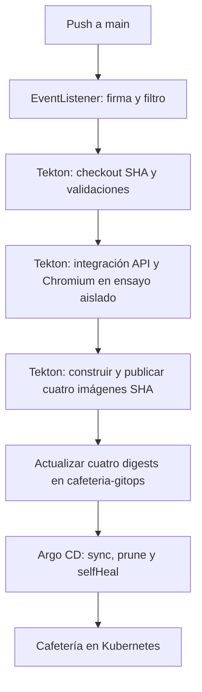

# Plan de CI/CD con Tekton y Argo CD

Actualizado: **27 de noviembre de 2026**, a partir del laboratorio y la demo del
profesor. Estado: plan pendiente de implementar y ejecutar en el clúster.
El [plan de trabajo](implementation-plan.md) define pasos, responsables por
frente y criterios de aceptación; este documento precisa el contrato del pipeline.

## Flujo objetivo



GitHub Actions conserva utilidad para revisar cambios durante el desarrollo.
La entrega ejecutará CI en Tekton y CD en Argo CD. Se retira del plan anterior
la Task `wait-e2e` que dependía de una ejecución de Actions: el propio pipeline
recogerá el resultado de las pruebas. No se ha implementado todavía esa migración.

## Del ejemplo docente a la cafetería

La demo `page-public-demo` incluye Tasks de clonación/build, workspace NFS,
PipelineRun y resultado `IMAGE_DIGEST`; su Application observa `k8s/` en el
mismo repositorio. Se reutilizan esos conceptos, adaptando:

- Dos repositorios: `cafeteria-app` para código/CI y `cafeteria-gitops` para CD.
- Cuatro contextos: `frontend`, `svc-menu`, `svc-pedidos`, `svc-lealtad`, cada uno
  con `Containerfile`. La ruta se resuelve relativa al contexto elegido.
- Checkout de SHA completo, en vez de depender de un `main` que pueda avanzar.
- Pruebas antes de publicar la entrega; actualización automática y conjunta de
  imágenes en GitOps, sin edición manual del tag durante la demostración.
- Tag SHA para trazabilidad y digest para fijar exactamente el artefacto.
- Compatibilidad de APIs y builder con el clúster; el material trae ejemplos
  `tekton.dev/v1` y `v1beta1`. Fijar versiones tras la comprobación.

## Tareas y resultados previstos

| Task | Entrada y resultado |
|---|---|
| `git-clone` | URL permitida + SHA; checkout aislado. |
| `validate-contracts` | Tres contratos OpenAPI válidos. |
| `python-check` | Cuatro ejecuciones con locks, Ruff, formato y pytest, incluyendo el contrato común. |
| `integration-tests` | Entorno de ensayo del mismo SHA, APIs, PostgreSQL y Chromium reales; informe de éxito/fallo. |
| `build-push` | Cuatro construcciones; URL, SHA y digest de cada imagen. Builder por fijar con plataforma. |
| `update-gitops` | Cuatro referencias verificadas en un commit; SHA promovido y revisión GitOps como resultados. |
| `cleanup-ci` | Limpieza del ensayo y workspace según política; diagnósticos limitados ante fallo. |

Pruebas Python por componente, desde su carpeta:

```sh
python -m pip install --require-hashes -r requirements.txt -r requirements-dev.txt
ruff check app tests ../tests/observability
ruff format --check app tests ../tests/observability
python -m pytest -c pyproject.toml tests ../tests/observability -p no:cacheprovider
```

El workspace se enlaza explícitamente entre Tasks mediante PVC por ejecución;
el StorageClass NFS debe soportar el acceso requerido. Un `emptyDir` aislado de
un pod no comparte automáticamente el checkout con los demás. Empezar las
construcciones en serie y medir recursos antes de aumentar el paralelismo.

## Integración y aislamiento

El runner de Compose controla stop, pause y restart. La CLI de Docker sola no
proporciona un motor. El paso 1 del plan debe cerrar la ruta: adaptar fixtures
para Kubernetes o acordar un motor aislado de CI que permita conservar Compose.
Ambas ejecutan las pruebas desde Tekton, conservan CSRF/CSP y verifican ledger,
persistencia y recuperación. Son referencia los 31 casos HTTP y 12 de Chromium.

Definir cómo preparar artefactos candidatos del mismo SHA en el entorno de
ensayo antes de la publicación de entrega; no promover candidatos sin validar.
El ensayo utiliza datos/PVC propios, recursos y plazos limitados y limpieza en
`finally`. Sus permisos quedan separados de `tienda`; no se introducen pruebas
de caída contra el entorno de exposición. Los detalles están en el
[plan de trabajo](implementation-plan.md#23-ci-dentro-de-tekton).

## Publicación y promoción

Usar las cuatro imágenes `docker.io/<cuenta>/cafeteria-{frontend,menu,pedidos,lealtad}:<SHA>`.
Los nombres y la cuenta se acuerdan antes de crear credenciales. La preferencia
previa era Buildah y la clase demuestra Kaniko: seleccionar una implementación
y su versión/digest según compatibilidad y permisos, sin copiar los tags de la demo.

Actualizar `overlays/production/kustomization.yaml` de GitOps (aún por crear),
renderizarlo y comprobar las cuatro imágenes antes del push normal sin force.
Ningún fallo de pruebas o construcción permite promover una combinación parcial.
Serializar promociones o verificar ascendencia del SHA para evitar que una
corrida anterior reemplace una versión más nueva que terminó antes.

Argo CD conserva el control de los recursos de tienda con sync automático,
prune y selfHeal. El bootstrap de plataforma se acuerda por separado. Mostrar
Synced/Healthy y la recuperación de un cambio manual de réplicas o Deployment.
La cuenta de CI no necesita aplicar recursos en `tienda` ni acceso de despliegue
a la API de Argo CD.

## Webhook, acceso y secretos

Primero probar un PipelineRun manual; luego EventListener, TriggerBinding y
TriggerTemplate. Validar firma GitHub y filtrar repo autorizado, evento push y
`refs/heads/main`, excluyendo borrados. Documentar el endpoint HTTPS o túnel.

Secrets separados para Docker Hub, escritura de GitOps y firma del webhook;
la lectura del código privado se configura si hace falta. Se elimina la
credencial para consultar Actions que requería el plan anterior. Usar
ServiceAccounts con permisos de cada función; no tokens en URLs, params o logs.

## Archivos a preparar

```text
tekton/
├── tasks/       # git-clone, validate-contracts, python-check, integration-tests,
│                # build-push, update-gitops y cleanup-ci
├── pipelines/   # cafeteria-ci.yaml
├── runs/        # manual.example.yaml
├── triggers/    # EventListener, Binding y Template
└── rbac/        # ServiceAccounts y roles por función
```

Orden: contrato de plataforma → PipelineRun de validación → integración y builds
→ manifiestos GitOps + Argo CD → webhook. No se instalaron componentes ni se
crearon recursos por actualizar este documento.

Referencias para implementar, comprobando la versión instalada:
[Workspaces](https://tekton.dev/docs/pipelines/workspaces/),
[Triggers](https://tekton.dev/docs/triggers/interceptors/#github-interceptors),
[sincronización Argo CD](https://argo-cd.readthedocs.io/en/stable/user-guide/auto_sync/).
